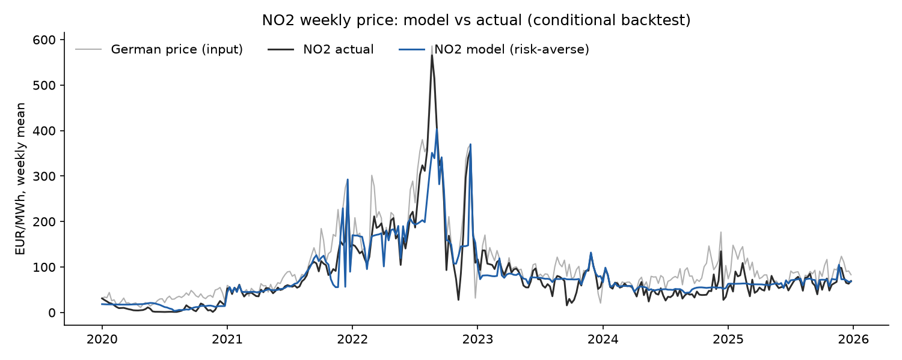
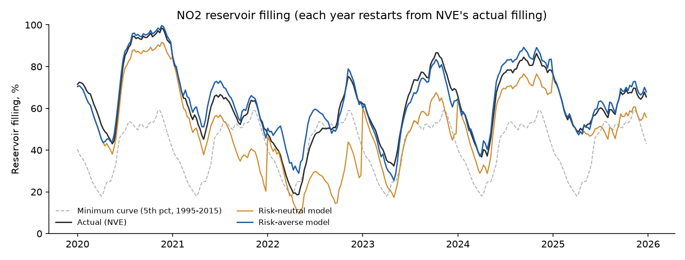
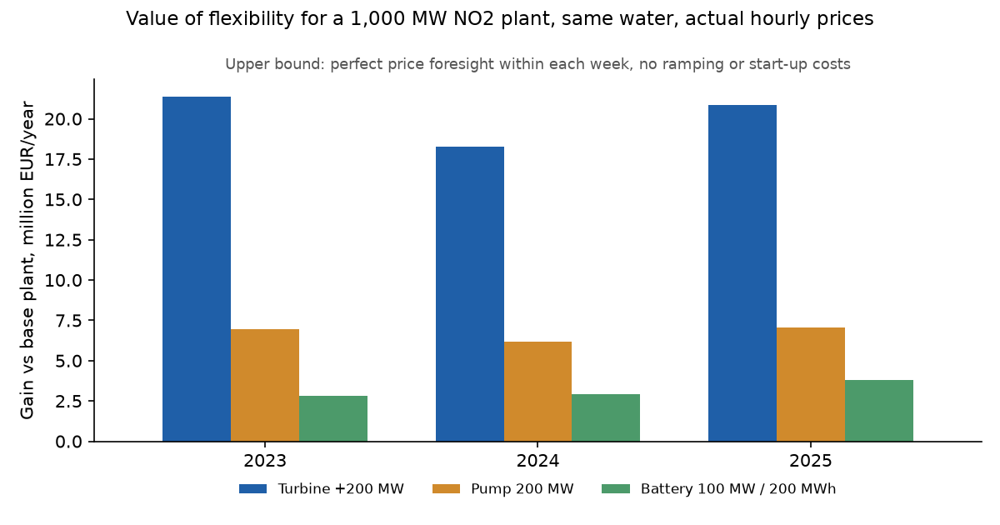

# Nordic Hydro Model

A simplified fundamental model of the NO2 (Southwest Norway) power market, built in two layers:

1. **Layer 1, weekly:** water values by stochastic dynamic programming for one aggregate reservoir, with market clearing against Germany over the interconnectors. It answers *what is water worth, and what will the area price be?*
2. **Layer 2, hourly:** dispatch of a single plant within each week, with turbine capacity, pumping and a battery. It answers *what is extra flexibility worth for one asset?*

The split mirrors how Nordic hydro producers work: a medium-term model sets the value of water week by week, and a short-term model places that water in the hours that pay most. This repository is a learning-scale version of that structure, tested against what actually happened in 2020 to 2025.

> This is not EMPS, Prodrisk or SHOP. It is one reservoir, one price area and weekly resolution in layer 1. Its purpose is to show the logic, the data work and the honest testing behind a fundamental price model, and where such a model breaks.

---

## Results at a glance

**Layer 1 reproduces NO2's discount to Germany.** In a conditional backtest (actual German prices, demand and cable capacity as inputs), the risk-averse model gets the yearly NO2 price within about 5 EUR/MWh in five of six years, and keeps reservoir filling within about 4 percentage points of NVE's figures in the same five years. 2022 is the exception.

| Year | NO2 actual | Model | German price | Filling error |
|---|---|---|---|---|
| 2020 | 9.3 | 14.3 | 30.3 | 2.6 pp |
| 2021 | 75.7 | 75.7 | 97.1 | 3.6 pp |
| 2022 | 211.5 | 190.7 | 235.8 | 7.2 pp |
| 2023 | 79.4 | 80.2 | 95.4 | 3.7 pp |
| 2024 | 50.2 | 54.9 | 78.6 | 3.3 pp |
| 2025 | 65.1 | 67.1 | 89.2 | 1.6 pp |

*Yearly mean prices in EUR/MWh. The exact match in 2021 is a coincidence of averages: the weekly error that year is still 13.5 EUR/MWh.*



**A risk-neutral model drains the reservoir; real producers do not.** Without risk aversion the model ended 2022 at 28% filling against an actual 63%. A soft minimum filling curve, built only from data before the test period, cut the average filling error from 12.3 to 4.5 percentage points on the calibration years (2020 to 2022) and from 9.7 to 2.8 on the years it was not tuned on (2023 to 2025).



**Layer 2: extra turbine capacity is worth about three times as much per MW as a pump or a battery in NO2.** For a representative 1,000 MW plant with the same water, at actual hourly prices 2023 to 2025:

| Upgrade | Gain per year | Per MW per year |
|---|---|---|
| Turbine +200 MW | 20.2 million EUR | about 100,000 EUR |
| Pump 200 MW | 6.7 million EUR | about 34,000 EUR |
| Battery 100 MW / 200 MWh | 3.2 million EUR | about 32,000 EUR |

These are **upper bounds** (see limitations). The ranking held in all three years.



---

## How it works

### Data

| Source | Series | Resolution | Period |
|---|---|---|---|
| NVE Magasinstatistikk | Reservoir filling and capacity, NO2 | Weekly | 1995 to 2026 |
| ENTSO-E Transparency | Day-ahead prices NO2 and DE-LU, load, hydro production by type, cross-border flows | Hourly | 2015 to 2026 |

German prices before October 2018 come from the former DE-AT-LU bidding zone. Day-ahead prices since 2025 are 15-minute and are averaged to hours.

### Weekly inflow (`src/nhm/inflow.py`)

Inflow is not published per price area, so it is backed out from a reservoir balance:

```
inflow = change in storage + reservoir production + run-of-river production
```

The series has the expected shape: about 300 GWh a week in late winter, a snowmelt peak above 2,000 GWh a week in weeks 19 to 25, and autumn rain. Yearly totals (2016 to 2025) average about 46 TWh and match known hydrology: 2020 was the wettest (55 TWh), 2021 the driest (34 TWh).

### Layer 1: water values (`src/nhm/sdp.py`)

Each week the system chooses how much reservoir water to release. What is not used at home is traded with the continent at the German price, within the cable limits:

```
V_w(S) = E_inflow [ max_R  p_DE * export  -  VOLL * shortage  -  penalty * (below minimum curve)
                           + beta * V_{w+1}(S') ]
```

The water value is the slope of V with respect to storage. The area price then follows from which constraint binds:

| Situation | NO2 price |
|---|---|
| No cable at its limit | German price |
| Export cables full (wet, full reservoirs) | Water value, below German |
| Import cables full (dry) | Water value, above German |

Interconnectors follow their commissioning dates (NordLink December 2020, North Sea Link October 2021). Inflow scenarios are the ten full years 2016 to 2025.

### The backtest (`src/nhm/backtest.py`)

The test is conditional: German prices, NO2 demand and cable capacity are taken from reality, so it isolates the model's structural error from errors in forecasting its inputs. To avoid hindsight:

* the test year's inflow is left out of the scenarios the model plans with
* the minimum filling curve uses only NVE data from 1995 to 2015
* the risk settings were chosen on 2020 to 2022 and checked on 2023 to 2025 (`results/risk_calibration.csv`)

Each year starts from NVE's actual filling.

### Risk aversion

Two mechanisms were tested:

* **Soft minimum filling curve:** each GWh below the 5th percentile of historical filling for that week costs 100 EUR/MWh in the optimisation. It stands in for the cost of running dry later.
* **CVaR tilt:** the expectation over inflow scenarios puts extra weight on the worst outcomes.

The minimum curve alone gave the best fit. The CVaR tilt on its own made the model hoard too much water, which suggests producers' caution behaves more like a floor than a general aversion to bad outcomes.

### Layer 2: hourly dispatch (`src/nhm/hourly.py`)

For each week, a linear programme (HiGHS via SciPy) places the plant's water in the best hours:

```
maximise  sum_h  price_h * (generation_h - pumping_h + discharge_h - charge_h)
subject to  weekly water budget, turbine and pump limits, battery state of charge
```

The plant's weekly water is its share of NO2's release from the risk-averse layer 1 run, in proportion to turbine capacity (1,000 MW is about 11.7% of NO2). Every variant gets the same water, so any gain comes from timing, pumping or battery trading.

---

## Known limitations

Stated plainly, because they matter for how the numbers should be read.

**Layer 1**
* One aggregate reservoir for all of NO2; no cascades, no individual plants.
* Weekly resolution. Within a week the cables flow both ways, so a weekly net flow overstates how much water can be exported. This is one reason the risk-neutral model drained the reservoir.
* German price, demand and internal flows (NO1, NO5) are inputs, not modelled.
* Missed the August 2022 peak: fear of rationing drove prices beyond what water values alone explain.
* Ten inflow years only. ENTSO-E hydro production starts in 2015, so earlier NVE reservoir data cannot yet be turned into inflow.

**Inflow**
* Spill is invisible in the balance, so inflow is underestimated in wet weeks with full reservoirs.
* NVE measures the largest reservoirs; ENTSO-E reports all production.
* NVE applies today's reservoir capacity to the whole history.
* A few negative weeks (5 of 611) come from timing differences between NVE and ENTSO-E.

**Layer 2**
* Upper bound: perfect price foresight within each week, no start-up costs, ramping limits or minimum flows.
* Price-taker: the plant's own dispatch does not move the price.
* No spillage gain: the plant's weekly water never exceeds base turbine capacity, because layer 1 caps NO2's release at the observed maximum. In reality a larger turbine also saves water from being spilled in the snowmelt, so this source of value is missing.
* Pumping assumes an unlimited lower reservoir. The battery trades day-ahead only; ancillary services, where much battery value lies in the Nordics, are not included.

---

## Run it

```bash
python -m venv .venv
.venv\Scripts\activate          # Windows; use source .venv/bin/activate elsewhere
pip install -r requirements.txt
cp .env.example .env            # then add your ENTSO-E API token

python scripts/fetch_nve.py
python scripts/fetch_entsoe.py          # 2015 to today, takes a while
python scripts/build_inflow.py
python scripts/build_weekly.py
python scripts/run_backtest.py
python scripts/calibrate_risk.py        # optional, about a minute
python scripts/export_hourly_prices.py
python scripts/run_valuation.py

python -m pytest -q                     # 16 tests
```

All assumptions (reservoir size, cables, risk settings, plant and variants) live in `config.toml`, so a new scenario is a config change.

## Repository layout

```
config.toml              every model assumption
src/nhm/
  inflow.py              weekly inflow from the reservoir balance
  weekly.py              weekly market inputs from hourly ENTSO-E data
  sdp.py                 layer 1: water values and simulation
  backtest.py            conditional backtest
  hourly.py              layer 2: hourly dispatch LP
scripts/                 data fetching, building and runs
tests/                   16 tests: balances, water value behaviour, dispatch logic
results/                 tables and figures
```

## Next

* A five-year NO2 price fan from simulated inflow years and a German price assumption.
* Extending inflow back to 1995 with older production statistics.
* Adding spillage to layer 2, so turbine upgrades get credit for saved water.

## Data and licence

Reservoir data: NVE, under the Norwegian Licence for Open Government Data (NLOD). Market data: ENTSO-E Transparency Platform. Code by Amalie Berg.